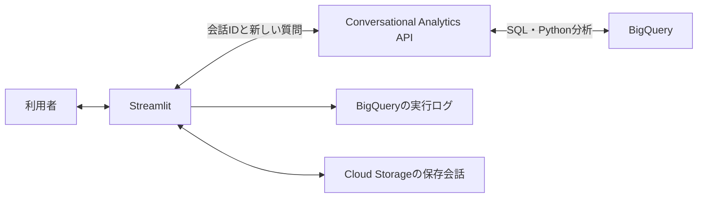

# ShiruGPT

BigQueryのデータを日本語で分析するStreamlitアプリです。
現在の既定方式は **Conversational Analytics API**。SQL生成・実行・結果の解釈・グラフ作成をデータエージェントへ依頼します。
アプリは質問の送信、API会話の継続、結果の表示、実行情報と履歴の保存を担当します。

## 最小構成



- 既定データセットは`202506`。最初の対象は`来店`テーブル1つ。
- 実在テーブルと列をアプリで確認し、列の業務定義と短い回答方針を登録します。
- 通常は新しい質問だけを送信。旧方式のツール一覧、`select_tools`、`finish_answer`、`context_note`は使用しません。
- SQL・取得結果・ジョブID・グラフ・公開された分析イベントを保存し、「データ・実行詳細」で確認できます。
- Cloud Storageを設定すれば、本人の会話を保存・復元できます。復元後も同じAPI会話IDで継続します。
- 回答ごとの費用概算を表示し、回答後60秒間は5秒おきに更新します。BigQueryジョブと、取得可能なネイティブ使用量ログから算出します。未取得は0とみなしません。[費用計測の設定・制約](docs/analytics-costs.md)を参照してください。

設計・移行条件・制約は[Conversational Analytics方式](docs/conversational-analytics.md)を参照してください。

## 起動

```bash
python3 -m venv .venv
.venv/bin/pip install -r requirements.txt
cp .env.example .env
```

`.env`に認証方法、`GCP_PROJECT_ID`、データセットを設定します。
`geminidataanalytics.googleapis.com`とBigQueryを利用できる権限が必要です。

```bash
gcloud auth application-default login
gcloud auth application-default set-quota-project <プロジェクトID>
.venv/bin/streamlit run app.py --server.address 127.0.0.1
```

```dotenv
ANALYSIS_BACKEND=conversational_analytics
ANALYTICS_LOCATION=global
ANALYTICS_TABLES=来店
ANALYTICS_TIMEOUT_SECONDS=300
```

## 制約と検証

- 登録対象テーブルは設定したデータセット内で照合します。実際のデータアクセス権限はGoogle Cloud IAMで制御してください。テーブル参照の登録や指示文はIAMの代わりにはなりません。
- APIが内部実行するSQLへ、旧方式のアプリ内SQL検査・実行前の費用確認は適用されません。`MAX_BYTES_BILLED`をAPI側のクエリ上限に指定します。
- APIが回答後に返すSQL・データもあるため、ストリームを最後まで受信して保存します。切断後の自動再試行はしません。停止は受信を中止する処理で、サービス内部の全処理の取消しは保証しません。
- SQLが正しくても、文章中の計算や解釈に誤りが残る場合があります。数値検閲や回答の差し替えは行いません。
- CountTokensは試験CLIの参考計測に利用できます。別モデルで登録用JSONを数えた値であり、分析API内部の使用量や請求量ではありません。
- Python分析を有効にしていますが、使用するかはAPIが判断します。回答にコードがあっても実行イベントがなければ実行済みとは確認できません。

```bash
.venv/bin/python -m unittest discover -s tests -q
PYTHONPATH=. .venv/bin/python scripts/benchmark_analytics.py --output /tmp/shirugpt-analytics-test --count-tokens
```

実API試験は、未使用の出力ディレクトリを指定してください。BigQueryと分析APIを実際に呼び出します。

旧方式は`ANALYSIS_BACKEND=gemini`で選択できます。旧方式の設計は[従来のアーキテクチャ](docs/architecture.md)、認証と公開設定は[セットアップ](docs/setup.md)を参照してください。
