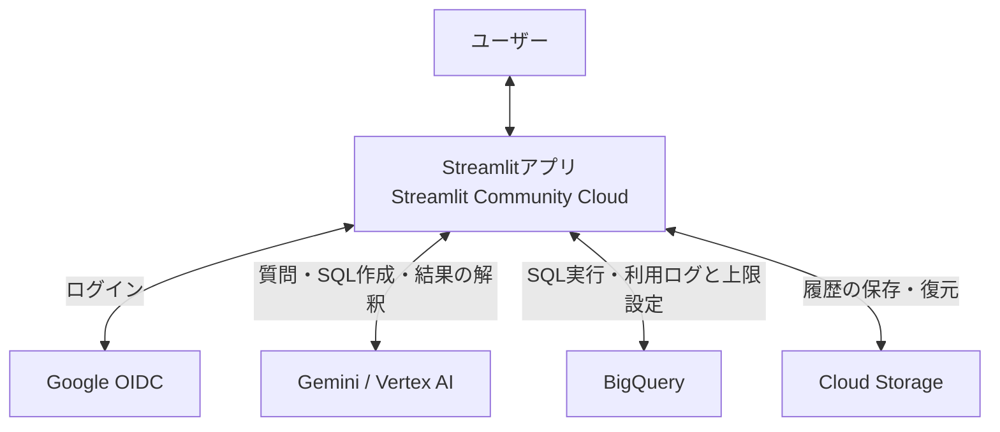

# ShiruGPT

日本語の質問から Gemini が SQL を作成し、BigQuery のデータを集計して回答する
Streamlit アプリです。現在は Streamlit Community Cloud に限定公開しているプロトタイプです。
一般知識を交えた課題発見、施策の検討、壁打ちにも対応します。

## 主な機能

- 期間・店舗・指標などが曖昧な場合、AI が確認質問を生成。選択肢・自由記述で回答できます。
- 棒・折れ線・面・散布図・円・ヒートマップに対応。AI が種類・軸・必要な内訳を選びます。
  元データ・SQL・実行量の確認と CSV 出力にも対応します。
- ログインした本人のチャット履歴を保存し、続きから分析できます。履歴は5件ずつ追加表示し、最近5件と開いた会話をキャッシュします。
- 利用者ごとの使用量記録・月次利用上限と、管理者向けの利用状況・設定確認に対応します。
- Gemini 3.8 Flashを通常はLowで使用します。`/effort` でLow／Medium／Highを選択でき、
  入力欄の枠はLow＝緑、Medium＝青、High＝紫です。`/thinking` はHighと詳細分析用の指示を適用し、再入力で解除します。
- 入力欄で `/` を打つとコマンド候補を表示します。クリック、または上下キーとEnterで実行できます（Tabは入力補完）。
- `/usage` では当月・全期間の会話数・質問数、トークン数、クエリ量、Gemini・BigQueryの費用を確認できます。

## 使用サービスと構成

| サービス・技術 | 役割 |
| --- | --- |
| Streamlit / Streamlit Community Cloud | チャット画面とアプリの実行・公開 |
| Google OIDC | Google アカウントによるログイン |
| Gemini / Vertex AI | 質問の解釈、確認質問・SQL の作成、結果の説明 |
| BigQuery | 分析データの集計、利用ログ・利用上限設定の保存 |
| Cloud Storage | 会話履歴・SQL・取得結果の保存と復元（任意設定） |



Gemini はツール呼び出しを要求し、アプリが SQL を検査して BigQuery で実行します。
アプリは小さい結果だけを直接返し、大きい結果は保存済みデータの分析ツールを通じて必要な情報だけGeminiに返します。
ツールは短い用途一覧から選び、選択したものだけ詳しい引数定義と専用の指示を読み込みます。
通常の応答に要点メモを添え、読み終えた結果や過去の会話の再送量を減らします。
必要な詳細は会話内の保存結果から再取得します（[設計](docs/context-budget-proposal.md)）。
利用ログは分析データから分離し、会話履歴の参照は開いている会話内に限定します。

## クイックスタート

Python と Google Cloud CLI を用意し、対象プロジェクトの API・権限を設定してください。
詳しい手順と Google ログインの設定は [セットアップ](docs/setup.md) を参照してください。

```bash
git clone https://github.com/junya34/shirugpt.git
cd shirugpt
python3 -m venv .venv
.venv/bin/pip install -r requirements.txt
cp .env.example .env
```

`.env` の `GCP_PROJECT_ID`、`BQ_DEFAULT_DATASET`、`BQ_ALLOWED_DATASETS` を設定して起動します。

```bash
gcloud auth application-default login
gcloud auth application-default set-quota-project <プロジェクトID>
.venv/bin/streamlit run app.py --server.address 127.0.0.1
```

ローカルで Google ログインを設定しない場合、チャット履歴は永続化されません。

## 主な制約

- 読み取り専用 SQL と、許可したデータセットへのアクセスに限定します。
  高コストのクエリには実行前の確認と課金上限を設けています。
- Geminiに直接渡すのは既定100行・推定トークン予算以内の結果です。中・大規模結果は列情報を先に渡し、
  保存済みデータを統計・集計・比較・ローカルSQLで分析して必要な部分だけ返します。グラフにも保存済み結果を利用します。
  画面用には既定で最大5,000行を取得し、SQLに `LIMIT` がなければ1,000行を自動付与します。
- SQL の集計粒度と回答の正しさは保証されません。重要な判断には「データ・実行詳細」で
  SQL と結果を確認してください。

## 開発・詳細資料

GCP に接続せずに回帰テストを実行できます。外部 API の実接続確認は別途必要です。

```bash
.venv/bin/python -m unittest discover -s tests -v
```

- [セットアップ・環境変数](docs/setup.md)
- [処理の流れ・集計と表示の方針](docs/architecture.md)
- [安全機構・データの扱い](docs/security.md)
- [利用ログ・月次利用上限・管理者ページ](docs/admin.md)

表データの段階的分析・返却予算・ローカルSQLの詳細は [docs/analysis-layer.md](docs/analysis-layer.md) を参照してください。
