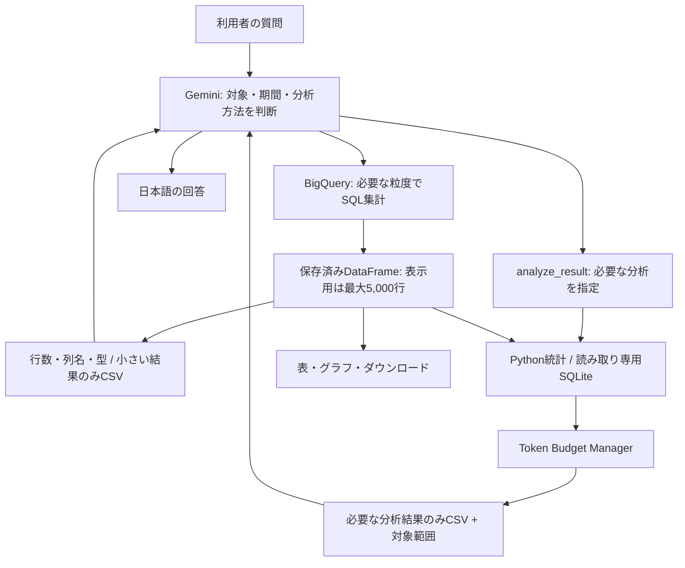

# 表データの段階的分析

> Do not move data to the LLM when computation can be moved to the data.

Geminiは分析方法の選択・解釈・説明を担当し、SQL/Pythonは抽出・集計・数値計算を担当します。
数千行を分割して読ませる処理を最初の解決策にしません。



## 既存構成との接続

- `src/bq_tools.py`: SQLガード、dry run、確認、課金上限を経て取得します。SQLは対象・期間・列・粒度を必要範囲に絞ります。
- `GeminiAgent._query_payload`: `TokenBudgetManager.initial_result`で初回返却を選びます。
- `src/analysis_layer.py`: 保存済み表に対する分析を実行します。任意のPythonコードは実行しません。
- `src/analysis_tools.py`: `analyze_result`の詳細定義。短いツール目録から選択された時だけ送信します。
- `ToolContext.analysis_cache`: 分析結果の全DataFrameを保持します。分析結果にもresult_idを付け、追加分析・履歴保存に使います。
- `src/token_budget.py`: データ返却と送信会話の予算制御。原本と画面用データは変更しません。
- `src/result_csv.py`: 列名をヘッダーに一度だけ書くCSVで転送します。長いセルや大整数を暗黙に省略しません。
- `src/context_memory.py`: 完了ターンの要点、直近の会話、必要時の履歴参照を組み立てます。

## 初回に送るもの

| 取得済み行数（既定） | 返却 |
| --- | --- |
| 0〜100行 | 推定データ予算内ならCSV。巨大文字列などで超える場合は列情報のみ |
| 101〜1,000行 | `size_class=medium`。result_id・列名・型・行数・取得範囲のみ |
| 1,001行以上 | `size_class=large`。行データを自動送信せず分析ツールを案内 |

`result_mode="schema"`なら、小さい結果も表示用としてメタデータだけ返せます。
`MAX_RESULT_ROWS`（既定5,000）とSQLの`DEFAULT_ROW_LIMIT`（既定1,000）は別の制限です。
`SAMPLE_ROWS`は旧形式の履歴保存用サンプル上限で、現在の初回返却行数を決めません。

```json
{
  "result_id": "result_example",
  "result": {
    "delivery": "schema",
    "size_class": "large",
    "row_count": 5000,
    "column_count": 3,
    "columns": [
      {"name": "month", "dtype": "str"},
      {"name": "store", "dtype": "str"},
      {"name": "visits", "dtype": "Int64"}
    ],
    "source_truncated": false,
    "sent_row_count": 0,
    "rows_omitted": 5000,
    "complete": false
  }
}
```

これは取得済み結果の情報です。`source_truncated`とSQLの`notes`で、元のクエリ結果からの
切り捨ても通知します。SQLのLIMIT・保存前の集計で失った情報は、ローカル分析では復元できません。

## 分析ツール

すべて`analyze_result(result_id, operation, ...)`で呼び出します。
`purpose`に何を確認する分析かを短い日本語で指定すると、「データ・実行詳細」の見出しに使います。
方法・条件・結果の表/CSV・元の行数・AIに返した行数・実行時間も表示し、会話履歴に保存します。
この表示用データをモデルの入力へ追加することはありません。
`filters`は最大5条件のANDで、列の型に合わせて比較し、分析前に適用します。

| operation | 主な指定 | 計算内容 |
| --- | --- | --- |
| `get_schema` | 任意の`columns` | 型・欠損数 |
| `get_row_count` | なし | 取得済み行・列数 |
| `describe_data` | `columns`（既定は先頭12列） | 欠損・件数・平均・中央値・標準偏差・分散・四分位・最小最大 |
| `aggregate` | `group_by`, `aggregations` | count/nunique/sum/mean/median/min/max/std/var |
| `top_k` | `sort_by`, `ascending`, `absolute` | 上位・下位・絶対値順。安定ソート |
| `filter_data` | `columns`, `filters`, `offset`, `sort_by` | 必要な範囲・列だけの参照 |
| `compare_groups` | 1列の`group_by`, `metric`, `aggregation`, `baseline` | 基準との差・変化率。基準未指定なら取得済み全体の同じ集計値 |
| `correlation` | 数値`columns`を2〜6列, `method` | Pearson/Spearman、ペアごとの有効件数。定数列・有効数3未満は未定義 |
| `detect_outliers` | `metric`, `method` | 1.5 IQRまたは3σの外れ値候補 |
| `analyze_timeseries` | `time_column`, `metric`, `group_by`, `frequency`, `window`, `view` | 増減量・変化率・移動平均。期間の欠損を0にしない |
| `get_distinct_values` | `columns`を1列 | 値ごとの結果行数 |
| `sample_data` | `columns`, `limit` | 再現可能な無作為順の例。代表性は保証しない |
| `sql` | `sql` | 保存済み`data`表に対するSQLite SELECT。CTE・windowにも対応 |

集計の合計は加算可能な指標に限ります。平均を単純平均したり、重複するユニーク人数を
合計したりして全体値を作ってはいけません。必要な分母・重み・元の識別子が保存されていなければ、
BigQuery側で再集計します。Pythonの平均は入力行に対する重みなしの平均です。

describeの標準偏差・分散は標本統計（ddof=1）、z-scoreの標準偏差はddof=0です。
時系列は同じ期間・内訳が重複する場合だけ`aggregation`を明示します。
欠けた期間をまたぐ差分と変化率、前期が0・負数の変化率は未定義にします。
時刻は入力の業務日時を維持し、根拠のない9時間加算はしません。

## 自由分析と追加分析

基本順序は、関連スキーマ → 基本統計 → カテゴリ・数値分布 → 有望なグループ比較 →
時系列 → 外れ値候補です。各結果を読んで次を選び、全組み合わせを列挙しません。
不要な分析を必ず実行する規則ではなく、質問と結果に応じて省略できます。

例えば店舗別に月次集計した表から、次のSQLで減少率を確認できます。

```json
{
  "result_id": "result_example",
  "operation": "sql",
  "sql": "WITH changes AS (SELECT month,store,visits,LAG(visits) OVER (PARTITION BY store ORDER BY month) AS previous FROM data) SELECT month,store,visits,previous,100.0*(visits-previous)/NULLIF(previous,0) AS change_pct FROM changes WHERE previous>0 ORDER BY change_pct LIMIT 10"
}
```

この例は前の観測月との比較です。欠けた月がある場合の厳密な前月比には
`analyze_timeseries`のギャップ判定、またはSQLで月の連続性の確認も必要です。

その後`filter_data`で該当店舗の推移だけを見ることができます。分析結果のresult_idを
次の分析に指定することもできます。原DataFrameは読み取りとして扱い、書き換えません。

## 予算と設定

`.env`・環境変数・Streamlit Secretsに対応し、管理者の実行設定にも表示します。

| 設定 | 既定値 | 用途 |
| --- | ---: | --- |
| `MAX_DIRECT_ROWS` | 100 | 直接CSV返却を許す行数 |
| `MEDIUM_RESULT_ROWS` | 1000 | 中規模と大規模の分類境界 |
| `MAX_PREVIEW_ROWS` | 50 | 分析結果・詳細参照の返却行数上限 |
| `MAX_DATA_TOKENS` | 8000 | 表データとそのメタデータの推定上限 |
| `TARGET_DATA_TOKENS` | 4000 | 縮小する場合の目標 |
| `MAX_HISTORY_TOKENS` | 16000 | 状態復元メモの推定上限。旧APIでは送信会話の推定上限 |
| `GEMINI_STATE_MAX_INPUT_TOKENS` | 32000 | Interactions APIの状態引き継ぎ基準。実入力＋出力＋追加差分の概算が80%に達したら要点で新状態へ |
| `ANALYSIS_TIMEOUT_SECONDS` | 3 | ローカルSQLの実行中断・Python処理前後の時間確認 |
| `BQ_QUERY_TIMEOUT_SECONDS` | 120 | BigQuery結果待機の上限。超過時はキャンセルを要求 |

推定は転送JSONのUTF-8バイト数/3のヒューリスティックです。DataFrame全量の削減前推定には
メモリ量も使います。モデルの`count_tokens`による実測や厳密な上限保証ではありません。
署名などのバイナリは送信時と同じbase64表現で数え、Pythonのbytes表記による過大評価を避けます。
元データの実測トークン数や料金を推定から断定しません。実入力・出力トークンは既存の利用ログで記録します。

分析結果はまず必要な処理で小さくし、それでも予算を超えたら目標予算まで行数を減らします。
巨大なセルを途中で切って元の値と誤認させません。1行も入らなければ列を絞るよう案内します。
表の計算結果全体は保存するため、返却しなかったグループを後から再分析できます。
ローカルSQLのみ返却上限+1行で読み取りを止め、総件数が不明なら下限であることを明示します。
そのSQL結果から追加分析する場合も、保存範囲の切り捨てを引き継ぎます。

既定のInteractions APIは、状態IDに新しい質問・ツール結果だけを追加します。
SQL・CSVの初回返却予算は上記のまま維持し、APIに保存済みの応答はアプリから再送しません。
入力上限接近・7日保持期限・旧会話の再開では、要点と結果IDから復元します。
復元時に数値の要点がなければ、保存済み結果を参照し直します。

以下は`GEMINI_API=generate_content`で使う旧APIの送信制御です。
通常の文章で完了し、要点メモがないターンも、次の質問では質問・最終回答の原文と結果目録で
引き継ぎます。過去のSQL・ツール応答の再送を省き、必要な詳細は`recall_context`で参照します。
未完了のターンは原文を維持します。

履歴は既存の要点化を先に使い、さらに予算を超えた時は古い巨大なツール応答から必要な分だけメタデータへ縮小し、
古いターンから除外します。原本・結果ID・直近の依頼・最新の未確認事項を維持します。
直近のツール応答は未読の結果を失わないよう省略せず、それだけで予算を超える場合はエラーにします。
進行中の署名付きmodel Partとfunction callは変更しません。それだけで上限を超える場合は、
質問・SQLを絞る案内を返します。要約専用のGemini呼び出しは追加しません。

## SQL境界と実行制限

BigQueryは既存のSELECT検査・AST・allowlist・LIMIT・課金確認を維持します。
ローカルSQLは会話ごとのメモリDBを作り、保存済み結果を`data`表として登録した後、
`query_only`とSQLite authorizerで読み取りに限定します。

- 1つのSELECTのみ。SQL ASTでも検査します。
- 他表・他DB・ファイル・拡張ロード・PRAGMA・書き込み・再帰CTEは禁止。
- 関数を許可リストで制限し、SQL長・式の深さ・文字列サイズも制限します。
- SQLiteのprogress handlerでタイムアウト・利用者の停止要求を確認します。
- Python統計処理は保存済み行数を対象とし、前後で停止・経過時間を確認します。プロセスを強制終了する方式ではありません。
- DecimalはSQLiteに正確な文字列として登録しますが、SQLite数値演算では近似になる場合があります。精密計算はBigQueryで行います。

任意のPythonコード、`eval`、外部からのSQL実行結果の読み込みは提供しません。

## 記録と検証

`src.agent`のINFOログにJSON形式の`analysis_metrics`を出します。質問・生成SQL・選択ツール・
処理名・実行時間・削減前後行数・推定トークン数・LLM呼び出しと実トークン数を記録します。
直近100件のツールメトリクスは`context_state.analysis_events`にも保存します。
`last_request`には履歴削減前後の推定値と省略数を記録します。
既存の使用量ログと費用・月次上限の計算は継続します。

外部APIなしのテストで、小・中・大規模結果、巨大セル、各分析の数値、自由分析の呼び出し順、
特定グループの追加参照、分析結果の履歴復元、予算・署名保全、SQLの拒否とタイムアウトを確認します。
自由分析の順序はモックモデルで検証し、実Geminiの分析精度・費用・時間は別途実接続での評価が必要です。
