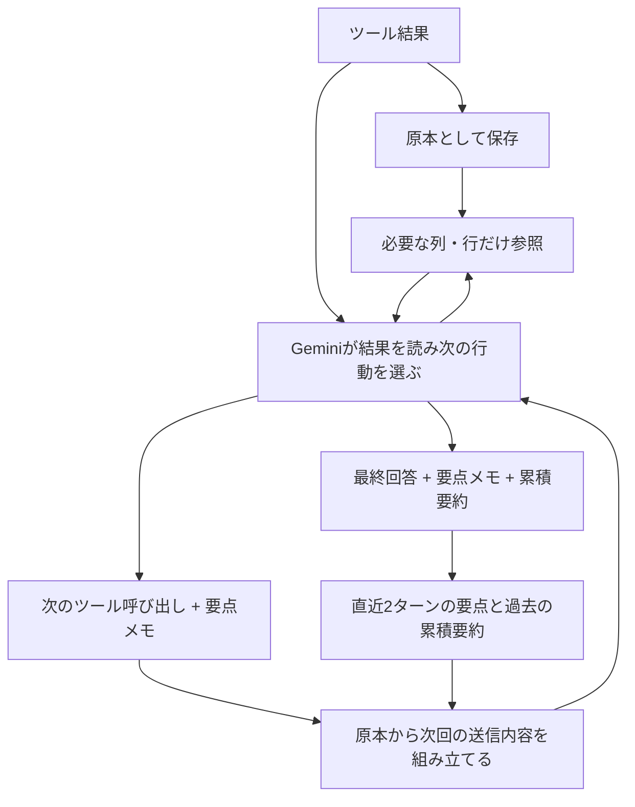
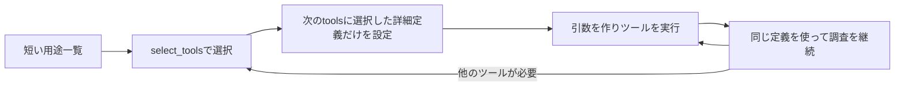

# 会話コンテキストの圧縮と詳細参照

実装は `src/context_memory.py`。アプリに残す原本と、Geminiに送る会話を分けます。
SQL・取得済みDataFrame・ツール応答・署名付きモデル応答は保存したまま、送信時にだけ短縮します。
画面の実行詳細、CSV、履歴の復元には原本を使います。



## ツールの詳細定義も選択して送る

`src/tool_catalog.py`に、7つのツール名と短い用途一覧を持たせています。初期状態でGeminiに
渡すFunction Declarationは、詳細を選択する軽い`select_tools`だけです。
既存のシステム指示と用途一覧は、引き続き各リクエストに含めます。



- `select_tools(names=[...])`で最大3つ選びます。選択はアプリ内で処理し、データ取得やSQL実行はしません。
- 詳しい説明・引数スキーマは、次の生成の`tools.function_declarations`に渡します。
  選択ツールの応答には使用可能になった名前だけを返し、同じ定義を応答JSONに重複掲載しません。
- 使用中の定義は会話ごとに保持し、同じツールを使う間は再選択しません。
  選択を切り替えると以前の組を置き換えるため、使い終わった全定義が増え続けることもありません。
- 例えば最初は一覧・スキーマ用3ツール、分析中は`run_query`と`finish_answer`という組を選べます。
  `select_tools`自体には大きな`context_note`定義を付けません。
- 選択状態は履歴にも保存します。旧履歴・不正な状態・モデル変更後は初期状態から再選択します。
  承認待ちの呼び出しと選択状態はそのまま保存・復元し、承認後の再開に不要な選択を追加しません。
- 定義選択と同時に要求された他の実行は行わず、次の生成で詳細を読んでから要求してもらいます。
  ユーザーへの確認質問が同時に来た場合は、従来どおり確認を優先します。
- 選択のためのGemini呼び出しも利用ログと調査ループの上限に含めます。
  **初回選択や切り替えでは往復が増える**ため、総費用が必ず減るとは限りません。

結果概要・絞り込み機能の追加前の計測では、定義JSONの文字数は全7定義で9,713文字、初期の選択ツールだけなら349文字、
`run_query`と`finish_answer`を選択した時は3,517文字です。これは定義部分だけの文字数で、
トークン数・料金の削減率ではありません。用途一覧・共通指示・実行結果・追加の選択往復は別途あります。
SDKの送信JSON・切り替え・会話間の分離・履歴・承認後の再開を外部接続なしでテストしています。
実APIの精度・応答時間・総入力トークンによる評価は別途必要です。
[GoogleのFunction Callingの説明](https://docs.cloud.google.com/gemini-enterprise-agent-platform/models/tools/function-calling)

## システム指示も用途ごとに分割する

`src/prompts.py`の`build_system_instruction()`で、選択中の定義と同じツール名から
必要な指示を組み立てます。全ツール向けの詳細指示を常時送る方式から切り替えています。

| 適用する範囲 | 指示 |
| --- | --- |
| 常時 | 日本語での分析支援、事実と仮説の区別、読み取り専用・アクセス制限・承認と課金上限の遵守、ツールの選び方、確認・回答の基本方針、最新の未確認事項を優先する規則 |
| 一覧・スキーマ取得 | 正しいデータセットIDの指定、必要なテーブルだけの確認と既知スキーマの再利用 |
| `run_query` | SQL構文、集計粒度、グラフ種類・軸、`purpose`・`result_role`、エラー修正と再試行 |
| `ask_clarification` | 事前のデータ確認、単一・複数選択、選択肢数、一般相談とデータ分析の区別 |
| `recall_context` | 保存済み範囲の列・行・SQL参照、ページ内統計と取得範囲・切り捨ての区別 |
| `finish_answer` | 回答の長さと表の重複抑制、最終回答と累積要約の作成 |
| 複数ツールで共有 | 指標の定義、日本時間・日時型の解釈、要点メモと未確認事項の更新 |

読み取り専用などの最小限の制約は、詳細が未選択の時にも残します。指標の定義・日時の詳細は
SQL作成だけでなく結果の参照や最終回答でも必要になるため、該当するツールにも付けます。
同じ共有指示を複数ツールが必要としても、一度だけ、一定の順序で追加します。
選択を切り替えれば、使わなくなったツール向けの指示も現在のシステム指示から外れます。
保存した過去のモデル応答を改変する仕組みではありません。

詳細分析モードの指示はツールの選択とは独立して、`/thinking`が有効な時だけ追加します。
SQL検査、承認、allowlist、課金上限のサーバー側の強制は変更していません。

指示分割時（結果概要・絞り込み機能の追加前）の計測では、全指示7,183文字に対し、初期状態は1,621文字、一覧・スキーマ用3ツールは2,700文字、
`run_query`単独は5,600文字、`run_query`と`finish_answer`は6,401文字です。
指示文だけの文字数であり、ツール定義や履歴・結果・選択の往復は含まず、トークンや料金の削減率でもありません。

## 通常の生成と一緒に要点を受け取る

ツール結果を読み、次の行動を決める既存のGemini呼び出しで、次のツールの引数に
`context_note`（要点と参照した`result_id`）を添えてもらいます。まだ受け取っていない結果や
別の会話の結果は参照できません。メモには対象・期間・指標の定義・単位・正確な数値・
除外条件などの確定した事実を箇条書きで残すよう指示します。未確認事項は別の一覧で管理し、
要点や累積要約に混ぜません。思考過程を保存する欄ではありません。

最終回答も、通常の生成で`finish_answer`を呼び、回答・今回の要点・会話全体の累積要約を
一緒に返します。アプリはこの回答をそのまま表示して終了し、ツール応答後の生成は行いません。
要約専用のGemini呼び出しは追加しませんが、メモの出力トークン自体は消費します。

## 未確認事項は現在の一覧だけで管理する

`context_note`には、確定した事実の`summary`とは別に、次の更新用配列を持たせます。

```json
{
  "summary": "- 店舗Aの売上は100万円。",
  "references": ["result_..."],
  "open_questions": [{"id": "sales_cause", "question": "売上減少は来客数の減少によるものか？"}],
  "resolved_questions": []
}
```

結果やユーザーの回答を読み、解決した場合は、同じ通常の生成で次を返します。

```json
{
  "summary": "- 売上・来客数はいずれも前月比20%減。客単価は同水準。",
  "references": ["result_..."],
  "open_questions": [],
  "resolved_questions": [{"id": "sales_cause", "conclusion": "売上減少は主に来客数の減少による。集計結果で確認。"}]
}
```

- アプリはIDごとに状態を保存し、送信の末尾には**現在も未解決の項目だけ**を配列で載せます。
  ツール応答が末尾の場合は、その応答JSON内の`current_question_state.open_questions`に入れます。
  `function_response`の後ろに別の`text` Partを付け足しません。
  全件解決した時も空の一覧を明示し、過去のメモを現状として扱わないよう指示します。
- 解決の結論は事実のメモに残し、疑問文を累積要約へ転載しないようにします。
  メモと結論の合計は1200文字以内です。
- 空配列・項目の省略は「変更なし」です。解決を明示しない限り、未確認事項を消しません。
  同時に保持できる未確認事項は12件まで。旧形式のメモも受け付けます。
- 未知のIDの解決、同じ更新内のID重複、解決済みIDの再利用を拒否します。
  同じターンで解決済みの疑問文を別IDで再登録することも防ぎます。
  別の分析では同じ文面の確認が必要になる場合があるため、新しいターンでは別IDで登録できます。
- 既知の疑問そのものの行や「未確認点: …」という独立した行は、過去の送信用メモから除きます。
  自由文の意味を解析して書き換える機能ではなく、言い換えまで機械的に検出する保証はありません。
- 原本の履歴は維持します。特に、進行中の署名付き呼び出し内にある昔の更新内容は変更しません。
  そこには疑問文が残ることがありますが、最新一覧を優先して解決済みの疑問を再度調べないよう指示します。
  原本の過去回答を明示的に参照する際も、歴史的な記録であることと現在の一覧を添えます。

解決したかの判断はGeminiが行います。アプリはその更新内容の形式・IDを検査して状態を反映します。
意味の正しさをアプリが自動判定する仕組みではありません。追加の要約用API呼び出しはありません。

## 次のリクエストに送るもの

| 範囲 | 送信する内容 |
| --- | --- |
| 進行中のターン | 質問、モデルの元のPart・呼び出し、未確認のツール結果 |
| 読み終えた大きな結果 | メモ、結果ID、列名・型、行数、切り捨ての注意。2000文字未満の応答はそのまま |
| 直近2つの完了ターン | 質問、ターンの要点、ツール別のメモと結果ID |
| それ以前 | その範囲までの累積要約、直近8件の過去質問の索引、詳細取得の案内 |

ツール別メモは1200文字、累積要約は4000文字以内です。参照IDやメモが不正な場合は
その結果を短縮しません。最終メモのない旧履歴・通常のテキスト回答は元のターンを保持します。
古い範囲にメモのないターンがあれば、その範囲の累積要約への置換も行いません。
さらにMAX_HISTORY_TOKENSで送信会話の推定予算を制御します。厳密な実トークン上限を保証するものではありません。

**進行中のFunction Callingは呼び出しID・署名・モデルPartを保持します。** そのため、現在の
呼び出し引数にあるSQLは残ります。完了後は過去のSQL全文を通常の送信内容から外します。
[Googleの思考署名の説明](https://docs.cloud.google.com/vertex-ai/generative-ai/docs/thought-signatures)

## 必要な詳細だけ再取得する

`recall_context`は、この会話の保存結果だけを参照するローカルツールです。

- `search`: 過去の質問・要点をキーワードで探す（最大5ターン）。
- `turn_id`: 過去の質問・回答・結果IDの一覧を確認する。
- `result_id`: 必要な`columns`、`offset`、`limit`を指定して行を取得する。
  既定20行、指定上限100行（実際の返却はMAX_PREVIEW_ROWSと推定予算でも制限）。SQLは`include_sql=true`のときだけ返す。
- `filters`: 保存済みの列に対する最大5条件のAND。`eq`・`in`・`gte`・`lte`・欠損判定に対応し、
  型に合う値で絞り込んでからページ分割します。一致行数と全保存行数を区別して返します。
- `action="present"`: `result_id`と`chart`で保存済み全結果を図示。列名・型を検証し、
  SQL再実行・再課金・行データの再送を行いません。読み取り時の条件は表示範囲を変えません。

初回は既定100行・推定トークン予算内ならCSV、それ以上は列情報・行数だけを返します。
`analyze_result`で統計・集計・Top-K・比較・相関・外れ値・時系列・ローカルSQLを実行し、
必要な分析結果だけをCSVで返します。表示用の最大5,000行は保持します。
推定データ予算は既定8,000、縮小目標4,000トークン、返却上限は既定50行です。
詳細は[表データの段階的分析](analysis-layer.md)を参照してください。

取得済みDataFrameから取り出すため、新しいBigQuery照会は行いません。最初の例示行を超える部分も、アプリに取得済みの範囲なら参照できます。ただし、アプリ自体の
取得上限で切り捨てた行は復元できません。返したページ・条件一致数・原結果の取得範囲を区別して返します。
旧履歴でDataFrameに結び付けられない場合は、保存済みCSVまたは旧形式のサンプルだけを返す旨を通知し、
全結果を対象にした絞り込みと図示は拒否します。
モデルがこのツールを要求する通常の生成と、その応答を読む次の生成にはトークンを消費します。

## ツール応答形式と送信末尾の補正

2026年10月25日のエラー履歴では、データセット一覧・テーブル一覧取得後の送信が
`user`の`[function_response, text]`という構造になっていました。末尾roleの確認だけでは
このケースを防げません。ツール応答には応答JSONだけを置き、未確認事項はそのJSONへ含めます。
既存の混在した履歴を送る場合も、補助テキストを`context_text`として応答JSONへ移します。
保存した原本・署名付きモデルPart・ツール名・呼び出しIDは保持します。
[GoogleのFunction Callingの応答例](https://docs.cloud.google.com/gemini-enterprise-agent-platform/models/tools/function-calling)


`build_request()`とAPI送信直前で、最後の空でないContentが`user`になることを確認します。
回答の再開などで末尾が`model`なら、原本を変更せず送信用の継続依頼を追加します。
末尾に空の`user`を置いてもAPI側で無視されるため、空の末尾は判定対象から外します。

応答がないツール呼び出しで終わっている場合は、名前・IDに対応する`function_response`を
付け、「履歴に応答がなく実行の成否は未確認」と明示します。この補正自体はツールを実行しません。
通常の承認待ちは従来どおり保存された呼び出しから再開するため、欠落応答の補正は使いません。
補正の発生は内容を含まない警告ログに残します。API失敗時には、送信件数・末尾12件のrole・
末尾Partの種類も記録します。質問・SQL・結果・署名そのものは追加記録しません。
通常の質問・ツール応答・署名はそのまま保持します。

## 保存と検証

メモと索引は会話履歴に保存します。旧形式はメモなしとして読み込み、モデル変更によって
会話を組み直した場合は索引をリセットします。承認待ちからの再開では現在の呼び出しを保ちます。
`ToolContext.context_state["last_request"]`に送信前後の文字数と短縮件数を記録します。
これはトークン数や実請求額ではありません。

回帰テストは、原本・署名・IDの保全、未確認結果の保持、階層化、詳細参照の範囲制限、
履歴保存・旧形式・モデル変更、実行承認からの再開を確認します。実APIでの回答精度・速度・
キャッシュ命中・実請求額を比較する評価は別途必要です。

現在の`/usage`は標準単価による概算です。キャッシュ割引分を分離した費用計算は未実装です。
[Googleのコンテキストキャッシュの説明](https://docs.cloud.google.com/vertex-ai/generative-ai/docs/context-cache/context-cache-overview)
