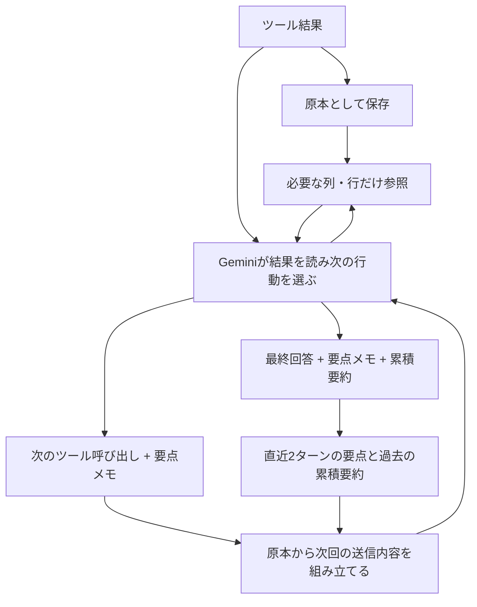

# 会話コンテキストの圧縮と詳細参照

実装は `src/context_memory.py`。アプリに残す原本と、Geminiに送る会話を分けます。
SQL・取得済みDataFrame・ツール応答・署名付きモデル応答は保存したまま、送信時にだけ短縮します。
画面の実行詳細、CSV、履歴の復元には原本を使います。



## 通常の生成と一緒に要点を受け取る

ツール結果を読み、次の行動を決める既存のGemini呼び出しで、次のツールの引数に
`context_note`（要点と参照した`result_id`）を添えてもらいます。まだ受け取っていない結果や
別の会話の結果は参照できません。メモには対象・期間・指標の定義・単位・正確な数値・
除外条件などの確定した事実を箇条書きで残すよう指示します。未確認事項は別の一覧で管理し、
要点や累積要約に混ぜません。思考過程を保存する欄ではありません。

最終回答も、通常の生成で`finish_answer`を呼び、回答・今回の要点・会話全体の累積要約を
一緒に返します。アプリはこの回答をそのまま表示して終了し、ツール応答後の生成は行いません。
要約専用のGemini呼び出しは追加しませんが、メモの出力トークン自体は消費します。

## 未確認事項は現在の一覧だけで管理する

`context_note`には、確定した事実の`summary`とは別に、次の更新用配列を持たせます。

```json
{
  "summary": "- 店舗Aの売上は100万円。",
  "references": ["result_..."],
  "open_questions": [{"id": "sales_cause", "question": "売上減少は来客数の減少によるものか？"}],
  "resolved_questions": []
}
```

結果やユーザーの回答を読み、解決した場合は、同じ通常の生成で次を返します。

```json
{
  "summary": "- 売上・来客数はいずれも前月比20%減。客単価は同水準。",
  "references": ["result_..."],
  "open_questions": [],
  "resolved_questions": [{"id": "sales_cause", "conclusion": "売上減少は主に来客数の減少による。集計結果で確認。"}]
}
```

- アプリはIDごとに状態を保存し、送信の末尾には**現在も未解決の項目だけ**を配列で載せます。
  ツール応答が末尾の場合は、その応答JSON内の`current_question_state.open_questions`に入れます。
  `function_response`の後ろに別の`text` Partを付け足しません。
  全件解決した時も空の一覧を明示し、過去のメモを現状として扱わないよう指示します。
- 解決の結論は事実のメモに残し、疑問文を累積要約へ転載しないようにします。
  メモと結論の合計は1200文字以内です。
- 空配列・項目の省略は「変更なし」です。解決を明示しない限り、未確認事項を消しません。
  同時に保持できる未確認事項は12件まで。旧形式のメモも受け付けます。
- 未知のIDの解決、同じ更新内のID重複、解決済みIDの再利用を拒否します。
  同じターンで解決済みの疑問文を別IDで再登録することも防ぎます。
  別の分析では同じ文面の確認が必要になる場合があるため、新しいターンでは別IDで登録できます。
- 既知の疑問そのものの行や「未確認点: …」という独立した行は、過去の送信用メモから除きます。
  自由文の意味を解析して書き換える機能ではなく、言い換えまで機械的に検出する保証はありません。
- 原本の履歴は維持します。特に、進行中の署名付き呼び出し内にある昔の更新内容は変更しません。
  そこには疑問文が残ることがありますが、最新一覧を優先して解決済みの疑問を再度調べないよう指示します。
  原本の過去回答を明示的に参照する際も、歴史的な記録であることと現在の一覧を添えます。

解決したかの判断はGeminiが行います。アプリはその更新内容の形式・IDを検査して状態を反映します。
意味の正しさをアプリが自動判定する仕組みではありません。追加の要約用API呼び出しはありません。

## 次のリクエストに送るもの

| 範囲 | 送信する内容 |
| --- | --- |
| 進行中のターン | 質問、モデルの元のPart・呼び出し、未確認のツール結果 |
| 読み終えた大きな結果 | メモ、結果ID、列名・型、行数、切り捨ての注意。2000文字未満の応答はそのまま |
| 直近2つの完了ターン | 質問、ターンの要点、ツール別のメモと結果ID |
| それ以前 | その範囲までの累積要約、直近8件の過去質問の索引、詳細取得の案内 |

ツール別メモは1200文字、累積要約は4000文字以内です。参照IDやメモが不正な場合は
その結果を短縮しません。最終メモのない旧履歴・通常のテキスト回答は元のターンを保持します。
古い範囲にメモのないターンがあれば、その範囲の累積要約への置換も行いません。
このため、送信サイズの厳密な上限を保証する仕組みではありません。

**進行中のFunction Callingは呼び出しID・署名・モデルPartを保持します。** そのため、現在の
呼び出し引数にあるSQLは残ります。完了後は過去のSQL全文を通常の送信内容から外します。
[Googleの思考署名の説明](https://docs.cloud.google.com/vertex-ai/generative-ai/docs/thought-signatures)

## 必要な詳細だけ再取得する

`recall_context`は、この会話の保存結果だけを参照するローカルツールです。

- `search`: 過去の質問・要点をキーワードで探す（最大5ターン）。
- `turn_id`: 過去の質問・回答・結果IDの一覧を確認する。
- `result_id`: 必要な`columns`、`offset`、`limit`を指定して行を取得する。
  既定20行、最大100行。SQLは`include_sql=true`のときだけ返す。

取得済みDataFrameから取り出すため、新しいBigQuery照会は行いません。最初の500行の
サンプルを超える部分も、アプリに取得済みの範囲なら参照できます。ただし、アプリ自体の
取得上限で切り捨てた行は復元できません。ページ内の統計と原結果の取得範囲を区別して返します。
旧履歴でDataFrameに結び付けられない場合は、保存済みサンプルだけを返す旨を通知します。
モデルがこのツールを要求する通常の生成と、その応答を読む次の生成にはトークンを消費します。

## ツール応答形式と送信末尾の補正

2026年10月25日のエラー履歴では、データセット一覧・テーブル一覧取得後の送信が
`user`の`[function_response, text]`という構造になっていました。末尾roleの確認だけでは
このケースを防げません。ツール応答には応答JSONだけを置き、未確認事項はそのJSONへ含めます。
既存の混在した履歴を送る場合も、補助テキストを`context_text`として応答JSONへ移します。
保存した原本・署名付きモデルPart・ツール名・呼び出しIDは保持します。
[GoogleのFunction Callingの応答例](https://docs.cloud.google.com/gemini-enterprise-agent-platform/models/tools/function-calling)


`build_request()`とAPI送信直前で、最後の空でないContentが`user`になることを確認します。
回答の再開などで末尾が`model`なら、原本を変更せず送信用の継続依頼を追加します。
末尾に空の`user`を置いてもAPI側で無視されるため、空の末尾は判定対象から外します。

応答がないツール呼び出しで終わっている場合は、名前・IDに対応する`function_response`を
付け、「履歴に応答がなく実行の成否は未確認」と明示します。この補正自体はツールを実行しません。
通常の承認待ちは従来どおり保存された呼び出しから再開するため、欠落応答の補正は使いません。
補正の発生は内容を含まない警告ログに残します。API失敗時には、送信件数・末尾12件のrole・
末尾Partの種類も記録します。質問・SQL・結果・署名そのものは追加記録しません。
通常の質問・ツール応答・署名はそのまま保持します。

## 保存と検証

メモと索引は会話履歴に保存します。旧形式はメモなしとして読み込み、モデル変更によって
会話を組み直した場合は索引をリセットします。承認待ちからの再開では現在の呼び出しを保ちます。
`ToolContext.context_state["last_request"]`に送信前後の文字数と短縮件数を記録します。
これはトークン数や実請求額ではありません。

回帰テストは、原本・署名・IDの保全、未確認結果の保持、階層化、詳細参照の範囲制限、
履歴保存・旧形式・モデル変更、実行承認からの再開を確認します。実APIでの回答精度・速度・
キャッシュ命中・実請求額を比較する評価は別途必要です。

現在の`/usage`は標準単価による概算です。キャッシュ割引分を分離した費用計算は未実装です。
[Googleのコンテキストキャッシュの説明](https://docs.cloud.google.com/vertex-ai/generative-ai/docs/context-cache/context-cache-overview)
